 <div align="center">

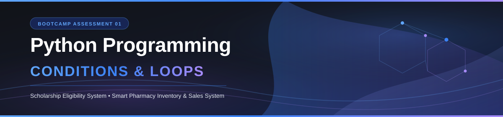

<br>

**A beginner-friendly Python project demonstrating conditional statements, loops, input validation, and practical calculations through two real-world applications.**

<br>


<br><br>

<a href="https://aliabbas0014.github.io/python-conditions-loops-assessment/demo.html">
  
</a>
<a href="https://github.com/aliabbas0014/python-conditions-loops-assessment">
  
</a>
<a href="#project-documentation">
  
</a>

</div>

---

## 📌 Table of Contents

- [Project Overview](#-project-overview)
- [Project Modules](#-project-modules)
- [Key Features](#-key-features)
- [Live Demo](#-live-demo)
- [Project Documentation](#-project-documentation)
- [Project Structure](#-project-structure)
- [Technologies Used](#-technologies-used)
- [Python Concepts Implemented](#-python-concepts-implemented)
- [Installation and Setup](#-installation-and-setup)
- [How to Run](#-how-to-run-the-programs)
- [Test Cases](#-test-cases)
- [Sample Outputs](#-sample-outputs)
- [Input Validation and Error Handling](#-input-validation-and-error-handling)
- [Learning Outcomes](#-learning-outcomes)
- [Limitations and Future Improvements](#-limitations-and-future-improvements)
- [Author](#-author)

---

## 📖 Project Overview

**Python Conditions & Loops Suite** is developed as part of a Python Programming Bootcamp assessment.

The project contains two independent console-based applications that demonstrate how Python programming concepts can be used to solve practical problems.

The first application determines student scholarship eligibility based on academic marks, attendance percentage, and monthly family income.

The second application manages pharmacy inventory by recording medicine details, processing sales, updating available stock, and calculating total revenue.

Both applications use Python's built-in functionality and fundamental programming techniques.

### 🎯 Project Objectives

- Understand conditional statements and decision-making.
- Practice `if`, `elif`, and `else` statements.
- Apply `for` and `while` loops.
- Use `range()` to repeat operations.
- Validate user input.
- Handle invalid inputs using `try` and `except`.
- Work with lists, counters, and accumulators.
- Perform calculations using arithmetic operators.
- Build practical console-based applications.

---

## 🧩 Project Modules

### 1. Student Scholarship Eligibility System

<badge color="info">Task 01</badge>

**File:** `student_scholarship_system.py`

This application evaluates a student's eligibility for a scholarship using three criteria:

| Eligibility Condition | Requirement |
|---|---:|
| Marks Percentage | 80% or above |
| Attendance Percentage | 85% or above |
| Monthly Family Income | Rs. 50,000 or less |

#### Scholarship Categories

- **Full Scholarship:** Marks are 90% or above and all eligibility conditions are satisfied.
- **Partial Scholarship:** Marks are between 80% and 89% and all eligibility conditions are satisfied.
- **Not Eligible:** One or more eligibility conditions are not fulfilled.

#### Main Features

- Accept student name and academic information.
- Check scholarship eligibility.
- Assign full or partial scholarship categories.
- Identify reasons for ineligibility.
- Validate marks, attendance, and income inputs.
- Display a complete scholarship eligibility report.

#### Function Structure

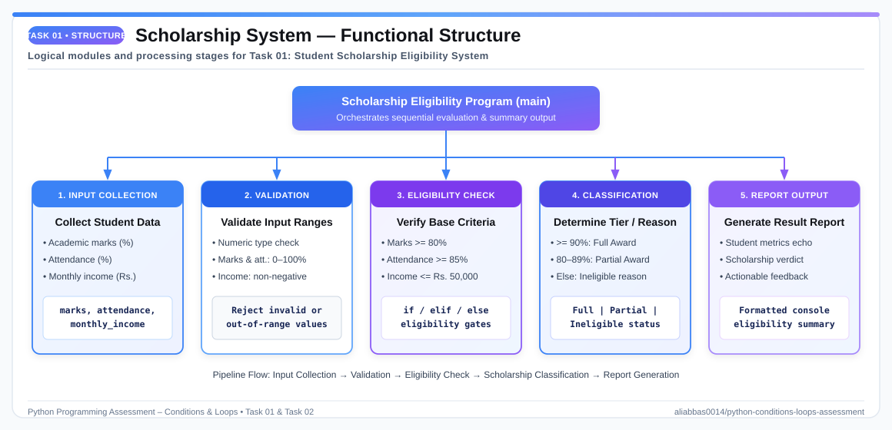

#### Scholarship Eligibility Flowchart

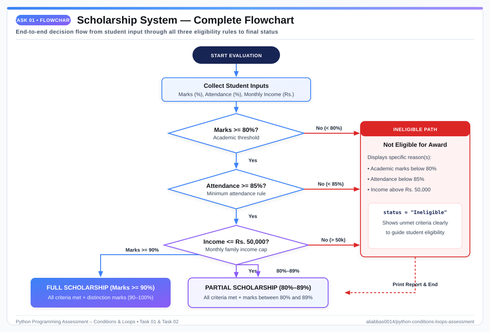

#### Eligibility Decision Diagram

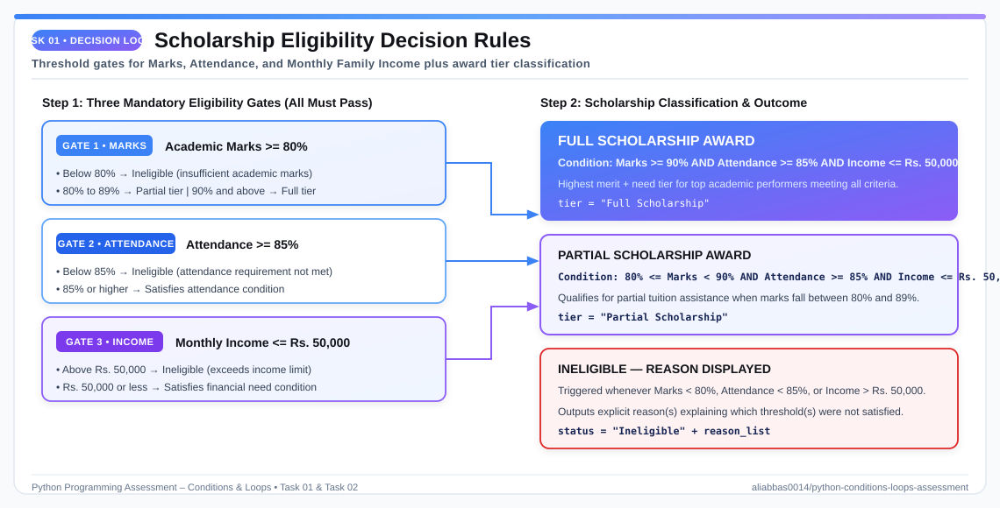

#### Scholarship Use Case

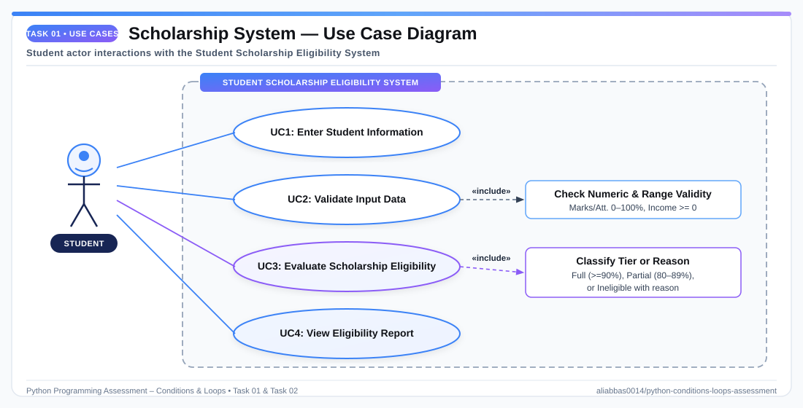

#### Scholarship Evaluation Process

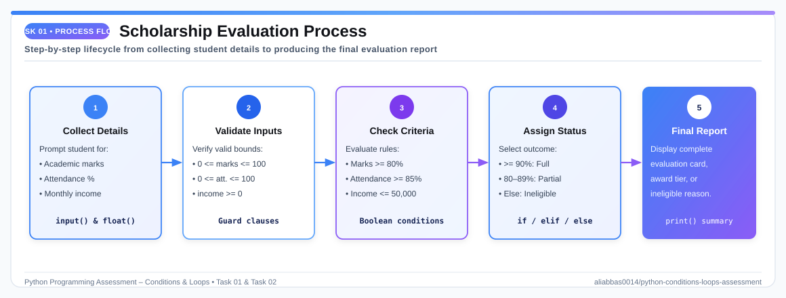

---

### 2. Pharmacy Inventory & Sales Management System

<badge color="discovery">Task 02</badge>

**File:** `pharmacy_inventory_system.py`

This application manages medicine inventory and calculates sales revenue based on stock availability and quantities sold.

#### Main Features

- Accept the number of medicines.
- Record medicine names, stock quantities, and prices.
- Accept the quantity sold for each medicine.
- Check available stock before processing sales.
- Calculate sales amount for each medicine.
- Update remaining stock.
- Display low-stock warnings when remaining stock is less than 10.
- Calculate total sales revenue.
- Count medicines requiring restocking.
- Display a final inventory and sales report.

#### Function Structure

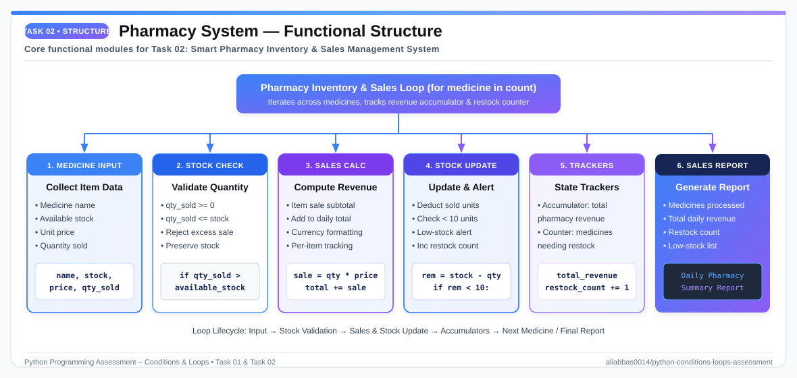

#### Pharmacy Inventory Flowchart

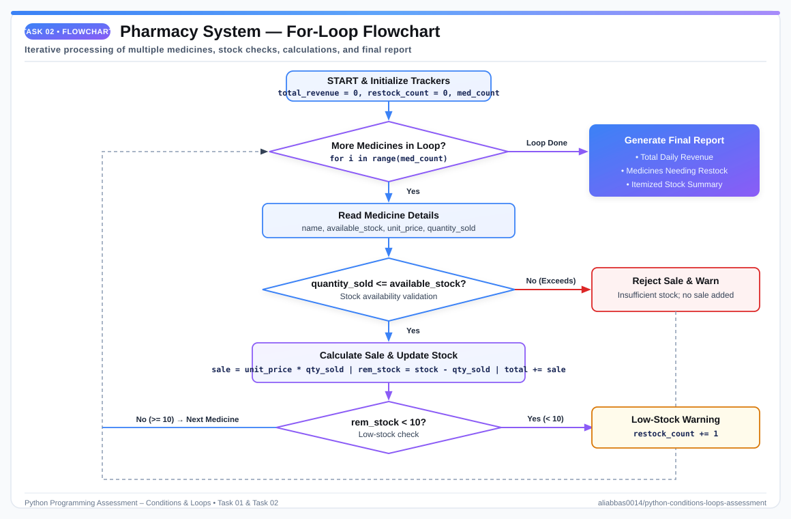

#### Inventory Management Workflow

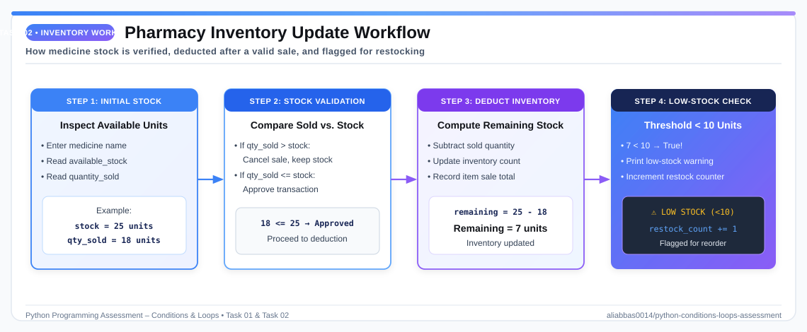

#### Pharmacy Sales Process

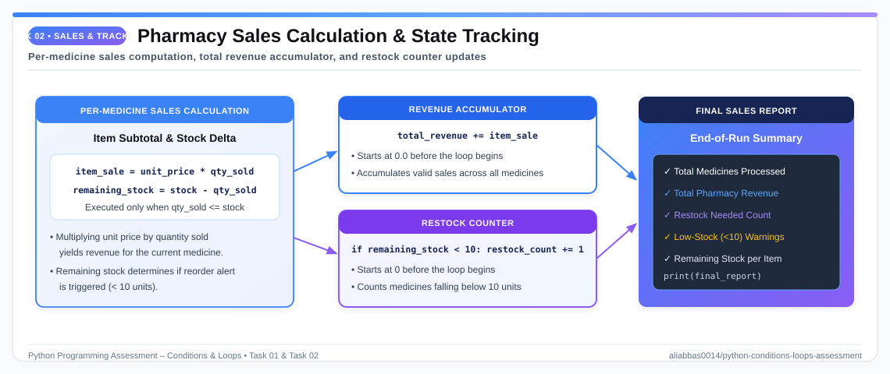

#### Pharmacy Use Case

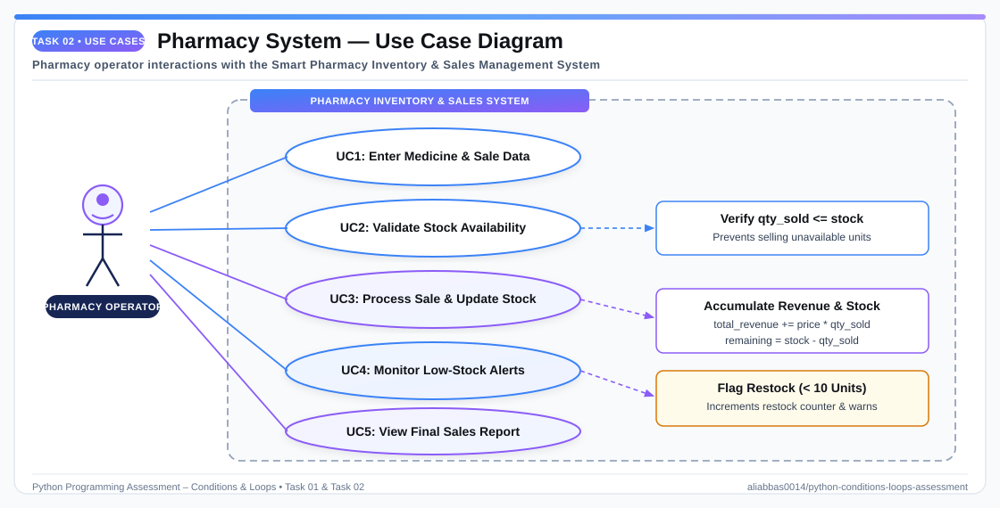

---

## ✨ Key Features

| Feature | Description |
|---|---|
| Scholarship Evaluation | Determine student eligibility using multiple conditions |
| Scholarship Categories | Assign full or partial scholarships |
| Eligibility Reasons | Identify conditions that were not fulfilled |
| Input Validation | Handle invalid marks, attendance, and income |
| Inventory Management | Record and process medicine information |
| Stock Verification | Check whether sufficient stock is available |
| Sales Calculation | Calculate revenue for each medicine |
| Stock Updates | Calculate remaining medicine quantities |
| Low-Stock Alerts | Identify medicines requiring restocking |
| Revenue Tracking | Calculate total pharmacy revenue |
| Counters and Accumulators | Track records and calculate totals |

---

## 🌐 Live Demo

Explore the interactive browser-based project showcase:

<div align="center">

<a href="https://aliabbas0014.github.io/python-conditions-loops-assessment/demo.html">
  
</a>

</div>

The demo provides a visual preview of both applications, including scholarship eligibility calculations and pharmacy inventory sales simulations.

**Note:** The browser demo is a JavaScript-based simulation for demonstration purposes. The actual applications are written in Python and must be executed separately in a Python environment.

---

## Project Documentation

This section contains additional diagrams explaining the overall architecture, input validation, testing, execution process, and Python programming concepts used throughout the project.

### 1. Overall Project Architecture

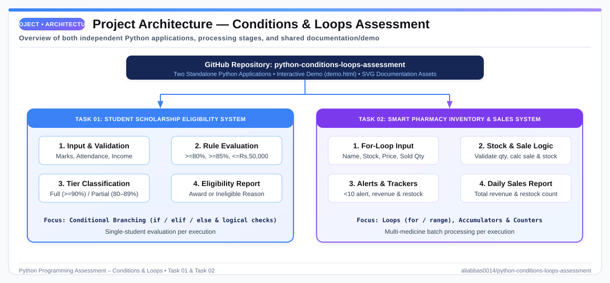

### 2. Input Validation Workflow

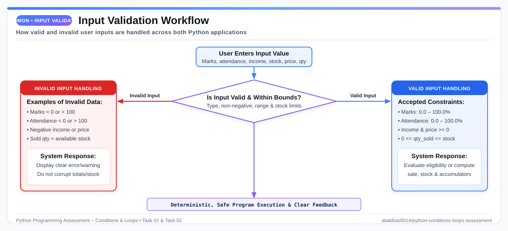

### 3. Testing and Test Cases

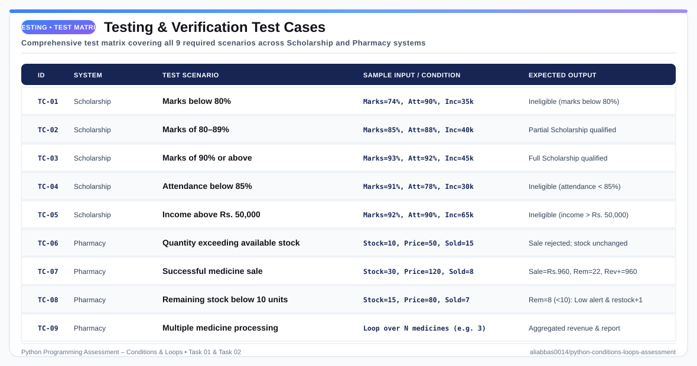

### 4. Program Execution Workflow

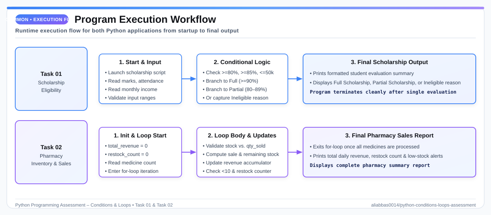

### 5. Python Concepts Overview

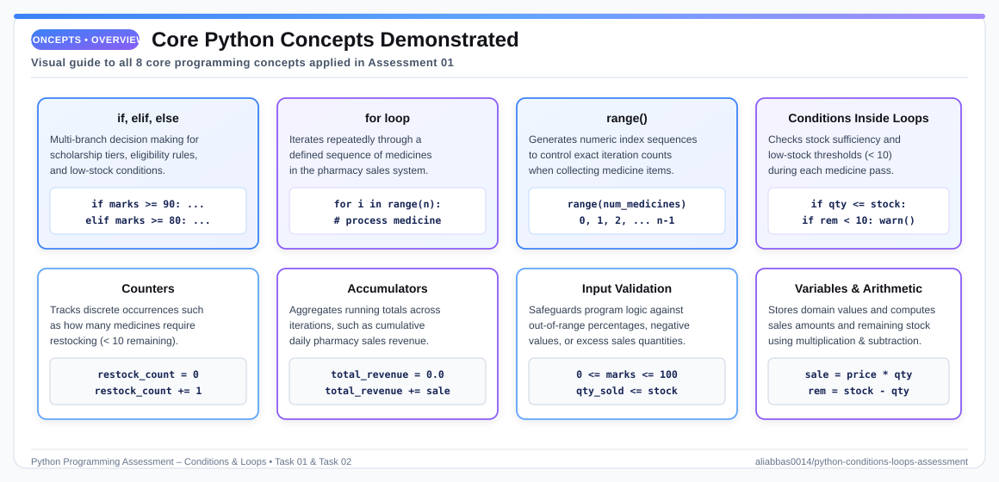

---

## 📁 Project Structure

```text
python-conditions-loops-assessment/
│
├── assets/
│   ├── assessment-01/
│   │   ├── header-banner.svg
│   │   ├── footer-banner.svg
│   │   ├── scholarship-function-structure.svg
│   │   ├── scholarship-flowchart.svg
│   │   ├── scholarship-eligibility-decision.svg
│   │   ├── scholarship-use-case.svg
│   │   ├── scholarship-evaluation-process.svg
│   │   ├── pharmacy-function-structure.svg
│   │   ├── pharmacy-flowchart.svg
│   │   ├── pharmacy-inventory-workflow.svg
│   │   ├── pharmacy-sales-process.svg
│   │   ├── pharmacy-use-case.svg
│   │   ├── project-architecture.svg
│   │   ├── input-validation-workflow.svg
│   │   ├── testing-test-cases.svg
│   │   ├── program-execution-workflow.svg
│   │   └── python-concepts-overview.svg
│   │
│   └── svg-buttons/
│       ├── live-demo.svg
│       ├── source-code.svg
│       └── explore-project.svg
│
├── student_scholarship_system.py
├── pharmacy_inventory_system.py
├── demo.html
└── README.md
```

---

## 🛠 Technologies Used

| Technology | Purpose |
|---|---|
| Python 3 | Main programming language |
| VS Code | Code editing and development |
| HTML5 | Demo page structure |
| CSS3 | Demo styling and animations |
| JavaScript | Interactive browser demonstration |
| SVG | README banners, buttons, and diagrams |
| Git | Version control |
| GitHub | Source code hosting |
| GitHub Pages | Hosting the live demo |

No external Python packages are required to run the two Python applications.

---

## 🧠 Python Concepts Implemented

| Concept | Purpose |
|---|---|
| Variables | Store student and medicine information |
| Input and Output | Use `input()` and `print()` |
| Conditional Statements | Make decisions using `if`, `elif`, and `else` |
| While Loops | Repeat input validation |
| For Loops | Process multiple medicines |
| Range Function | Repeat operations for a specific number of medicines |
| Lists | Store scholarship ineligibility reasons |
| Try and Except | Handle invalid user input |
| Counters | Count medicines requiring restocking |
| Accumulators | Calculate total pharmacy revenue |
| Arithmetic Operators | Calculate sales and remaining stock |
| Comparison Operators | Check eligibility and stock conditions |
| Logical Operators | Combine multiple eligibility conditions |

---

## ⚙️ Installation and Setup

### Prerequisites

Make sure the following tools are installed:

- Python 3.x
- Visual Studio Code or another Python-supported editor
- Git (optional, for cloning the repository)

### Step 1: Clone the Repository

Open your terminal and run:

```bash
git clone https://github.com/aliabbas0014/python-conditions-loops-assessment.git
```

### Step 2: Open the Project Folder

```bash
cd python-conditions-loops-assessment
```

### Step 3: Verify Python Installation

```bash
py --version
```

If the Python launcher is unavailable, try:

```bash
python --version
```

No additional Python libraries or dependencies need to be installed.

---

## ▶️ How to Run the Programs

### Application 1: Student Scholarship System

```bash
py student_scholarship_system.py
```

Enter the requested student information and review the scholarship eligibility report.

### Application 2: Pharmacy Inventory System

```bash
py pharmacy_inventory_system.py
```

Enter the number of medicines and provide the requested inventory and sales information.

Both applications run in the terminal and accept input directly from the user.

---

## 🧪 Test Cases

The following test cases describe the expected behavior of both applications under different input scenarios.

### Application 1: Student Scholarship Eligibility System

| Test ID | Test Scenario | Expected Result |
|---|---|---|
| SS-01 | Marks 95, attendance 90, income 40,000 | Full Scholarship |
| SS-02 | Marks 85, attendance 90, income 40,000 | Partial Scholarship |
| SS-03 | Marks below 80 | Not Eligible |
| SS-04 | Attendance below 85 | Not Eligible |
| SS-05 | Income above Rs. 50,000 | Not Eligible |
| SS-06 | One or more eligibility conditions fail | Display reasons for ineligibility |
| SS-07 | Enter invalid marks or attendance | Display validation message |
| SS-08 | Enter invalid income | Handle invalid input and request valid input |

### Application 2: Pharmacy Inventory Management System

| Test ID | Test Scenario | Expected Result |
|---|---|---|
| PI-01 | Medicine has sufficient stock | Sale processed successfully |
| PI-02 | Quantity sold is greater than available stock | Sale rejected due to insufficient stock |
| PI-03 | Remaining stock is less than 10 | Display low-stock warning |
| PI-04 | Remaining stock is 10 or more | No low-stock warning |
| PI-05 | Multiple medicines are entered | Process all medicines using a loop |
| PI-06 | Different medicine prices and quantities | Calculate individual sales correctly |
| PI-07 | Multiple successful sales | Calculate total revenue correctly |
| PI-08 | One or more medicines need restocking | Update restocking counter |

*These are documented test scenarios and expected results. Actual test execution results should be recorded separately if required.*

---

## 💼 Use Cases

### Student Scholarship Eligibility System

| Use Case | Description |
|---|---|
| Student Evaluation | Evaluate a student's scholarship eligibility |
| Scholarship Classification | Identify full and partial scholarship categories |
| Eligibility Verification | Check marks, attendance, and family income |
| Ineligibility Reporting | Explain why a student does not qualify |

### Pharmacy Inventory Management System

| Use Case | Description |
|---|---|
| Medicine Registration | Enter medicine details and available stock |
| Sales Processing | Process medicine sales |
| Stock Verification | Check available quantities before a sale |
| Inventory Updates | Calculate remaining stock |
| Restocking Identification | Identify medicines with low remaining stock |
| Revenue Calculation | Calculate total sales revenue |

---

## 📊 Sample Outputs

### Student Scholarship Eligibility System

**Sample Input:**

```text
Enter student name: Ali
Enter marks percentage: 95
Enter attendance percentage: 90
Enter monthly family income: 40000
```

**Expected Output:**

```text
Student Name: Ali
Scholarship Status: Eligible
Scholarship Category: Full Scholarship
```

### Pharmacy Inventory Management System

**Sample Input:**

```text
Number of medicines: 2

Medicine 1: Panadol
Available stock: 20
Price per unit: 50
Quantity sold: 5

Medicine 2: Syrup
Available stock: 8
Price per unit: 100
Quantity sold: 3
```

**Expected Output:**

```text
Medicine: Panadol
Sales Amount: Rs. 250.00
Remaining Stock: 15

Medicine: Syrup
Sales Amount: Rs. 300.00
Remaining Stock: 5
Warning: Low stock! Restocking required.

Total Medicines: 2
Total Revenue: Rs. 550.00
Medicines Requiring Restocking: 1
```

*Sample outputs are illustrative examples based on the assessment requirements.*

---

## 🛡 Input Validation and Error Handling

Both applications include input validation to reduce errors caused by incorrect user entries.

### Student Scholarship System

- Validates marks percentage.
- Validates attendance percentage.
- Validates monthly family income.
- Handles invalid numeric input using `try` and `except`.
- Checks scholarship conditions before assigning a category.

### Pharmacy Inventory System

- Validates medicine information and numeric values.
- Checks available stock before processing a sale.
- Prevents sales when the requested quantity exceeds available stock.
- Displays low-stock warnings when remaining stock is less than 10.

---

## 🎓 Learning Outcomes

Through this assessment, the following programming skills were practiced:

- Understanding conditional statements.
- Using `if`, `elif`, and `else` for decision-making.
- Applying `for` and `while` loops.
- Repeating operations using `range()`.
- Validating user input.
- Handling errors with `try` and `except`.
- Working with lists, counters, and accumulators.
- Performing calculations using arithmetic operators.
- Applying programming logic to practical problems.
- Developing independent console-based applications.

---

## 🚀 Limitations and Future Improvements

The applications focus on fundamental Python programming concepts. Some possible improvements include:

- Add a graphical user interface.
- Store scholarship records in a file or database.
- Add medicine search, editing, and deletion.
- Generate pharmacy sales reports.
- Add medicine expiry-date tracking.
- Maintain inventory history.
- Add automated unit testing.
- Introduce database integration.

---

## 👨‍💻 Author

<div align="center">


### Ali Abbas

**Software Engineering Graduate | Python Bootcamp Student | Web Developer**

<br>


<br><br>

<a href="https://github.com/aliabbas0014">
  
</a>
<a href="https://www.linkedin.com/in/the-aliabbas/">
  
</a>
<a href="https://aliabbas0014.github.io/Portfolio/">
  
</a>

<br><br>

If you find this project useful, consider giving it a ⭐ on GitHub!

</div>

---

<div align="center">


</div>
